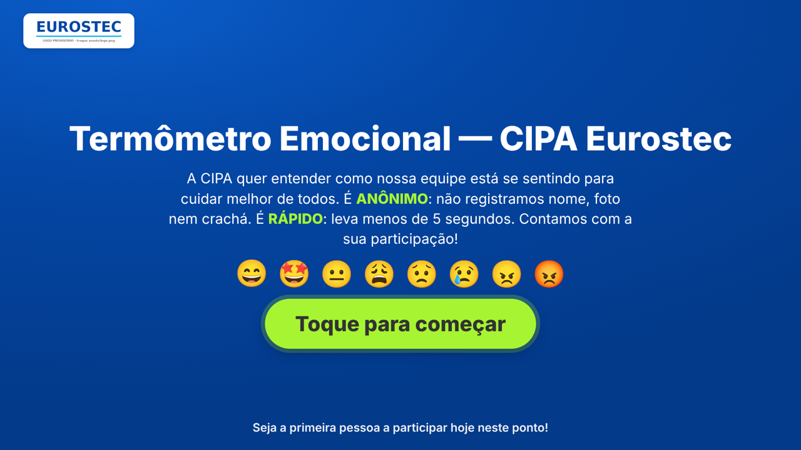
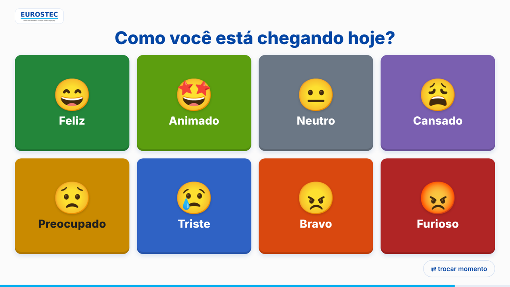
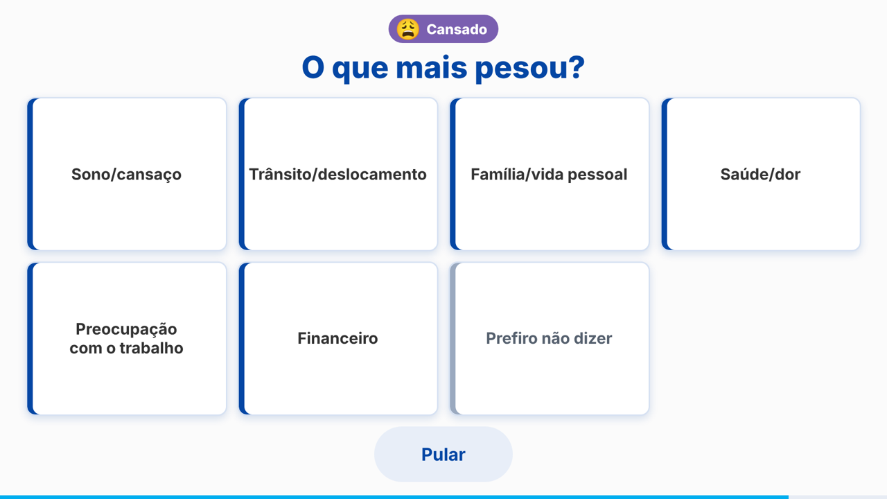
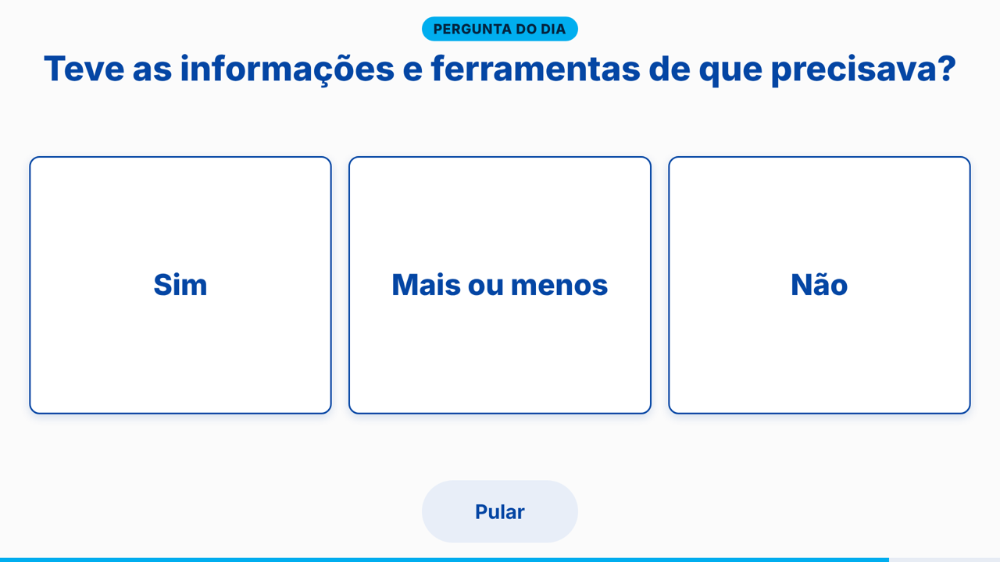
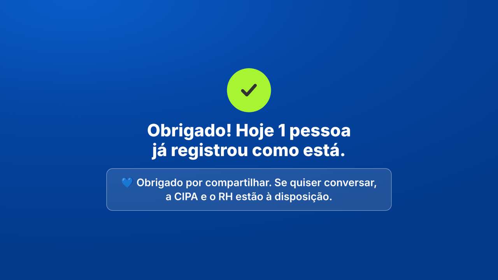
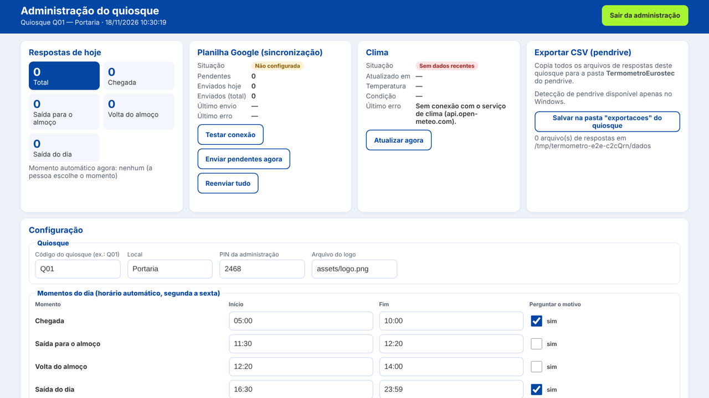

# Termômetro Emocional — CIPA Eurostec

Sistema de **quiosque com tela de toque** para a CIPA registrar, de forma **anônima**, como a equipe se sente em quatro momentos do dia: **chegada, saída para o almoço, volta do almoço e saída**. Cada pessoa leva menos de 5 segundos: toca na tela, escolhe uma emoção e, em alguns momentos, o motivo.

- **Não há câmera, nome, matrícula, crachá nem texto livre.** Nada que identifique a pessoa é gravado.
- Funciona **sem internet**: os dados ficam no próprio computador e são enviados para a planilha central quando a conexão volta.
- A cada quinzena, um duplo clique gera o **relatório** (página com gráficos + planilha Excel).

| Tela inicial | Emoções | Motivo |
|---|---|---|
|  |  |  |
| **Pergunta do dia** | **Agradecimento** | **Administração** |
|  |  |  |

---

## Sumário

1. [Como funciona](#1-como-funciona)
2. [O que você vai precisar](#2-o-que-você-vai-precisar)
3. [Instalar um quiosque (passo a passo)](#3-instalar-um-quiosque-passo-a-passo)
4. [Configuração de cada quiosque](#4-configuração-de-cada-quiosque)
5. [Área de administração](#5-área-de-administração)
6. [Deixar o quiosque sempre ligado](#6-deixar-o-quiosque-sempre-ligado)
7. [Planilha Google central (Apps Script)](#7-planilha-google-central-apps-script)
8. [Plano B: exportar para pendrive](#8-plano-b-exportar-para-pendrive)
9. [Relatório quinzenal](#9-relatório-quinzenal)
10. [Dados gravados](#10-dados-gravados)
11. [Privacidade e anonimato](#11-privacidade-e-anonimato)
12. [Executáveis (.exe)](#12-executáveis-exe)
13. [Testes e dados fictícios](#13-testes-e-dados-fictícios)
14. [Problemas comuns](#14-problemas-comuns)
15. [Estrutura de pastas](#15-estrutura-de-pastas)

---

## 1. Como funciona

```
QUIOSQUE (um computador Windows por ponto de coleta)
  Microsoft Edge em modo quiosque  ──►  servidor do Termômetro (só no próprio computador)
                                          ├─► dados\respostas_Q01_2026-11-20.csv   (cópia principal)
                                          ├─► fila de envio ──internet──► Planilha Google central
                                          └─► clima (Open-Meteo) a cada 15 min

COMPUTADOR DA CIPA
  CSVs do pendrive e/ou CSV baixado da planilha ──► gerar_relatorio.bat ──► relatório .html + .xlsx
```

### O que a pessoa vê

1. **Tela inicial:** tocar em qualquer lugar começa.
2. **Momento do dia:** é escolhido sozinho pelo horário (de segunda a sexta). Fora dos horários, no fim de semana e nos feriados, a pessoa escolhe entre 4 botões grandes.
3. **Emoção (1º toque):** Feliz, Animado, Neutro, Cansado, Preocupado, Triste, Bravo ou Furioso. **A resposta é gravada neste toque.**
4. **Motivo (só na chegada e na saída):** opcional, com botão "Pular". Quem escolhe Neutro não vê esta tela.
5. **Pergunta do dia (só na saída):** Sim / Mais ou menos / Não, com "Pular".
6. **Agradecimento:** mostra só quantas pessoas já participaram hoje naquele ponto. Para Triste, Bravo e Furioso aparece também uma mensagem acolhedora.

| Momento | Horário automático | Pergunta na tela | Pergunta o motivo? |
|---|---|---|---|
| Chegada | 05:00 – 10:00 | Como você está chegando hoje? | Sim |
| Saída para o almoço | 11:30 – 12:20 | Como você está saindo para o almoço? | Não |
| Volta do almoço | 12:20 – 14:00 | Como você está voltando do almoço? | Não |
| Saída do dia | 16:30 – 23:59 | Como você está saindo hoje? | Sim + pergunta do dia |

O início faz parte da janela e o fim não. Por exemplo, 12:20 já conta como "Volta do almoço". Na tela de emoções, há sempre um botão pequeno **"trocar momento"**.

**Tempos:**
- Após **6 s** sem toque em qualquer tela, o quiosque volta ao início. Uma barrinha azul na parte de baixo mostra esse tempo.
- O agradecimento fica **1,5 s** na tela, ou **4 s** quando há a mensagem acolhedora.
- Proteção contra toque duplo: um novo registro só começa **2 s** depois do último, e ao trocar de tela há uma trava de 0,5 s.

---

## 2. O que você vai precisar

**Em cada quiosque:**
- Computador com **Windows 10 ou 11**, tela de toque e **Microsoft Edge**, que já vem no Windows.
- Internet (recomendada; sem ela tudo continua funcionando e os dados são enviados depois).
- **Não precisa de Python** se a pasta `bin` tiver o `TermometroQuiosque.exe` (veja a [seção 12](#12-executáveis-exe)).

**No computador da CIPA (relatórios):**
- Windows 10 ou 11. Use o `TermometroRelatorio.exe` ou, se ele não estiver na pasta `bin`, o **Python 3.12**, que o `instalar.bat` tenta instalar sozinho.

**Uma conta Google** para a planilha central (a mesma conta que vai "ser dona" da planilha).

---

## 3. Instalar um quiosque (passo a passo)

1. **Copie a pasta** `TermometroEmocional` para o computador do quiosque, por exemplo em `C:\TermometroEmocional`. Evite a Área de Trabalho e pastas sincronizadas com OneDrive.
2. Dê **dois cliques em `instalar.bat`** e escolha **1 (Quiosque)**. Ele vai perguntar:
   - **Código do quiosque**, por exemplo `Q01`, `Q02`, `Q03`. Use um código diferente em cada ponto.
   - **Local**, por exemplo `Portaria`, `Produção` ou `Refeitório`.
   - **PIN da administração**, de 4 a 8 números.
   - Se quer que o quiosque **abra sozinho quando o Windows ligar**. Recomendado: **S**.
3. Ainda no instalador, aceite **ajustar a energia** para a tela nunca desligar.
4. Dê **dois cliques em `iniciar_quiosque.bat`**. O Edge abre em tela cheia com o Termômetro.
5. Configure a **planilha central** pela área de administração ([seção 7](#7-planilha-google-central-apps-script)).
6. Faça o **teste de 5 minutos** abaixo.

> **Atenção:** se o Windows mostrar "O Windows protegeu o computador" ao abrir um `.exe`, clique em **Mais informações → Executar assim mesmo**. Isso acontece com programas internos que não têm assinatura digital. Se a empresa usa antivírus corporativo, peça à TI para liberar a pasta do Termômetro.

### Teste de 5 minutos (faça em cada quiosque)

1. Toque na tela inicial, escolha uma emoção negativa e depois um motivo. Deve aparecer "Obrigado! Hoje 1 pessoa…".
2. Espere 6 s parado na tela de emoções. Ela deve voltar sozinha ao início.
3. Segure o dedo **3 segundos no canto superior direito** e digite o PIN. Confira:
   - em "Respostas de hoje", deve aparecer 1;
   - em "Clima", a situação deve estar "Atualizado";
   - em "Planilha Google", use **Testar conexão**.
4. Abra a Planilha Google e confira se a linha chegou (pode levar até 1 minuto).
5. Desligue e ligue o computador. O quiosque deve abrir sozinho.

---

## 4. Configuração de cada quiosque

Cada quiosque tem o seu arquivo **`config\config.json`**, criado na instalação. A maior parte pode ser alterada pela **área de administração**, sem abrir o arquivo. O modelo completo, com todos os valores padrão, está em `config\config.exemplo.json`.

Se preferir editar o arquivo à mão, use o Bloco de Notas, salve e reinicie o quiosque. Antes de salvar pela área admin, o sistema confere tudo e guarda uma cópia da configuração anterior em `config\backups`.

| Campo | Para que serve | Padrão |
|---|---|---|
| `kiosk_id` | Código do quiosque (letras, números, `-` ou `_`) | `Q01` |
| `kiosk_local` | Nome do local | `Portaria` |
| `pin_admin` | PIN da administração, **entre aspas** | `"2468"` |
| `logo` | Caminho da imagem do logo | `assets/logo.png` |
| `expediente.dias` | Dias com detecção automática do momento | segunda a sexta |
| `feriados` | Datas sem detecção automática, ex.: `["2026-12-25"]` | vazio |
| `momentos.<momento>.inicio` / `fim` | Janela de horário de cada momento | tabela da seção 1 |
| `momentos.<momento>.pergunta` | Pergunta que aparece na tela | textos da seção 1 |
| `momentos.<momento>.perguntar_motivo` | Liga/desliga o motivo naquele momento | chegada e saída ligados |
| `emocoes` | Lista de emoções: nome, emoji, cor, cor do texto, pontuação, valência e se mostra a mensagem acolhedora | 8 emoções |
| `motivos` | Listas de motivos (positivo/negativo) da chegada e da saída | listas da especificação |
| `pergunta_do_dia.ativa` | Liga/desliga a pergunta do dia | ligada |
| `pergunta_do_dia.perguntas` | Perguntas em rodízio (uma por dia, igual em todos os quiosques) | 5 perguntas |
| `pergunta_do_dia.mostrar_para_neutro` | Quem escolhe Neutro também vê a pergunta do dia | sim |
| `textos` | Todos os textos das telas (título, convite, rodapé, agradecimento, acolhimento…) | — |
| `tempos` | Tempos em segundos (inatividade 6, agradecimento 1,5, acolhimento 4, bloqueio 2…) | — |
| `clima.latitude` / `longitude` | Local para o clima | Caxias do Sul/RS: -29.168, -51.179 |
| `sincronizacao.url` / `token` | Endereço e senha da planilha central | vazio |
| `porta` | Porta do servidor (se mudar, mude também `PORTA` no `iniciar_quiosque.bat`) | 8080 |

Nos textos, `{x}` é trocado pela contagem do dia e `**palavra**` aparece em **destaque**.

**Pontuação padrão das emoções:** Feliz +2, Animado +2, Neutro 0, Cansado −1, Preocupado −1, Triste −2, Bravo −2, Furioso −3.

**Logo:** troque o arquivo `assets\logo.png` pelo logo oficial, de preferência PNG com fundo transparente e formato horizontal. Recarregue a tela pela área admin.

---

## 5. Área de administração

**Como abrir:** segure o dedo por **3 segundos no canto superior direito** da tela e digite o PIN. Ela fecha sozinha após 2 minutos sem uso.

| Parte | O que mostra / faz |
|---|---|
| Respostas de hoje | Total e quantidade por momento, e qual momento automático vale agora |
| Planilha Google | Situação, pendentes, enviados hoje/total, último envio, último erro. Botões: **Testar conexão**, **Enviar pendentes agora**, **Reenviar tudo** (manda todo o histórico de novo, sem duplicar) |
| Clima | Última atualização, temperatura, condição. Botão **Atualizar agora** |
| Exportar CSV | Copia os arquivos para o pendrive ([seção 8](#8-plano-b-exportar-para-pendrive)) |
| Configuração | Código, local, PIN, logo, horários dos momentos, motivo ligado/desligado, pergunta do dia, clima, URL e token da planilha. O **Editor avançado** dá acesso a todas as opções (textos, emoções, motivos, perguntas) |
| Sistema | **Recarregar tela** e **Fechar o quiosque** (volta para o Windows) |

Para digitar na tela de toque, use um teclado físico ou o teclado virtual do Windows (veja a [seção 6](#6-deixar-o-quiosque-sempre-ligado)).

---

## 6. Deixar o quiosque sempre ligado

O `configurar_inicio_automatico.bat` (também chamado pelo `instalar.bat`) faz quatro coisas:
- cria o atalho para o quiosque abrir quando o usuário entra no Windows;
- ajusta **Tela** e **Suspensão** para **Nunca**, na tomada e na bateria;
- desliga a hibernação automática;
- desliga a proteção de tela.

Para desfazer o início automático, use `remover_inicio_automatico.bat`. A própria página do quiosque também pede ao Windows para manter a tela acesa.

**Confira também, uma vez em cada quiosque:**

1. **Login automático do Windows.** Sem isso, depois de uma queda de energia o computador para na tela de senha.
   - Aperte `Windows + R`, digite `netplwiz` e dê Enter.
   - Desmarque "Os usuários devem digitar um nome de usuário e uma senha para usar este computador", clique em OK e digite a senha do usuário.
   - No Windows 11, se a opção não aparecer, desligue antes em *Configurações → Contas → Opções de entrada* a opção "Para maior segurança, permita somente a entrada do Windows Hello…".
   - Recomendado: use um usuário local só para o quiosque, sem direitos de administrador.
2. **Ligar após queda de energia:** algumas máquinas têm no BIOS/UEFI a opção "Restore on AC Power Loss" (ou parecida), que liga o computador sozinho quando a energia volta. Peça à TI.
3. **Windows Update:** em *Configurações → Windows Update → Opções avançadas → Horário ativo*, defina **05:00 às 23:00** para o Windows não reiniciar no horário de coleta.
4. **Data, hora e fuso:** em *Configurações → Hora e idioma → Data e hora*, deixe "Definir horário automaticamente" ligado e o fuso **(UTC-03:00) Brasília**. O momento do dia depende do relógio.
5. **Teclado virtual (para a área admin):** em *Configurações → Hora e idioma → Digitação → Teclado virtual*, peça para mostrar o teclado virtual quando não houver teclado conectado. No Windows 10 a opção fica em *Configurações → Dispositivos → Digitação*.
6. **Para sair do modo quiosque:** área admin → **Fechar o quiosque**. Com teclado, `Alt + F4` também fecha. Para abrir de novo, use `iniciar_quiosque.bat` ou reinicie o computador.

> **Avançado:** o Windows tem o "Acesso atribuído" (modo quiosque do sistema), que trava o computador num único aplicativo. Ele não é necessário para o Termômetro, mas pode ser usado pela TI se quiser mais bloqueio.

---

## 7. Planilha Google central (Apps Script)

Todas as respostas de todos os quiosques vão para **uma Planilha Google**. Cada resposta tem um código único (`response_id`): se ela chegar de novo, por exemplo num reenvio ou quando a pessoa escolhe o motivo, a linha existente é **substituída**, nunca duplicada.

### Publicar (uma vez só)

1. Entre no **Google Drive** com a conta da CIPA e crie uma **Planilha Google** nova, por exemplo "Termômetro Emocional — CIPA".
2. Na planilha, abra o menu **Extensões → Apps Script**.
3. No editor que abrir, apague todo o conteúdo do arquivo `Código.gs` (ou `Code.gs`).
4. Abra o arquivo **`apps_script\Code.gs`** desta pasta com o Bloco de Notas, copie tudo e cole no editor.
5. Na linha `const TOKEN = 'TROQUE-ESTE-TOKEN';`, troque `TROQUE-ESTE-TOKEN` por uma **senha longa**. Exemplo: `Cipa2026-Termometro-7Hq2xP9`. Use letras, números e hífen, sem espaços e sem aspas. **Anote essa senha:** é o *token* que vai em cada quiosque.
6. Clique no ícone de **disquete** (Salvar) ou aperte `Ctrl + S`.
7. Na barra de cima, escolha a função **`configurarPlanilha`** e clique em **Executar**. O Google vai pedir autorização:
   - clique em **Revisar permissões** e escolha a conta;
   - se aparecer "O Google não verificou este app", clique em **Avançado → Acessar (não seguro)**. Isso é normal para scripts próprios;
   - clique em **Permitir**;
   - na planilha, aparece a aba **Respostas** com os títulos das colunas.
8. Clique em **Implantar → Nova implantação**:
   - na engrenagem ao lado de "Selecione o tipo", escolha **App da Web**;
   - Descrição: `v1`;
   - **Executar como:** *Eu* (o seu e-mail);
   - **Quem pode acessar:** *Qualquer pessoa*;
   - clique em **Implantar** e copie a **URL do App da Web**, que termina em `/exec`.
9. **Teste:** cole a URL no navegador. Deve aparecer "o App da Web está funcionando".
10. **Em cada quiosque:**
    - abra a área admin → Configuração → Planilha Google;
    - cole a **URL** e o **token** e toque em **Salvar configuração**;
    - toque em **Testar conexão**. Deve aparecer "Conectado à planilha…".

    Na primeira vez que a URL é salva, **todas as respostas já gravadas naquele quiosque são enviadas** automaticamente.

> **"Qualquer pessoa"** é necessário porque o quiosque não faz login no Google. A proteção é o **token**: sem ele, nada é gravado. Se a conta for do Google Workspace e essa opção não aparecer, peça ao administrador do Google da empresa para permitir apps da web com acesso "Qualquer pessoa".

### Se precisar alterar o código depois

Vá em **Implantar → Gerenciar implantações → lápis (editar) → Versão: Nova versão → Implantar**. Assim **a URL continua a mesma**. Se criar uma "Nova implantação", a URL muda e precisa ser trocada em todos os quiosques.

### Como funciona o envio

- Cada resposta entra numa **fila** gravada no disco (`estado\fila_envio.json`) e é enviada em poucos segundos. A emoção e o motivo da mesma pessoa normalmente seguem juntos.
- **Sem internet**, a fila guarda tudo e tenta de novo sozinha: primeiro após 10 s, depois espaçando até no máximo 5 min. Nada se perde, mesmo se o computador for desligado.
- O CSV local continua sendo a cópia principal. A planilha é a consolidação.

---

## 8. Plano B: exportar para pendrive

1. Conecte o pendrive no quiosque e espere alguns segundos.
2. Abra a área admin e, em **Exportar CSV**, toque em **Exportar para E: (nome do pendrive)**.
3. Os arquivos são copiados para `E:\TermometroEurostec\Q01\`. Espere 5 segundos antes de retirar o pendrive.

Sem pendrive, o botão **Salvar na pasta "exportacoes" do quiosque** faz uma cópia em `exportacoes\` dentro da pasta do Termômetro.

---

## 9. Relatório quinzenal

### Preparar (uma vez, no computador da CIPA)

Rode `instalar.bat` e escolha **2**. Isso instala o necessário, a menos que a pasta `bin` já tenha o `TermometroRelatorio.exe`.

### Gerar

1. Coloque os dados na pasta **`entrada_relatorio`**, de uma (ou das duas) formas:
   - **CSV da planilha central:** na Planilha Google, *Arquivo → Fazer download → Valores separados por vírgula (.csv)*, com a aba Respostas aberta;
   - **CSVs dos pendrives:** copie as pastas `TermometroEurostec\Q01`, `Q02`…

   Pode misturar as duas formas: **respostas repetidas são removidas automaticamente**, e fica a versão mais completa.
2. Dê **dois cliques em `gerar_relatorio.bat`**.
   - Digite a **data inicial** e a **data final** da quinzena, por exemplo `2026-11-03` e `2026-11-14`, ou só aperte Enter para usar todos os dados.
   - Dica: você pode **arrastar uma pasta** com CSVs para cima do `gerar_relatorio.bat`.
3. O relatório é salvo em **`relatorios\`** e abre sozinho no navegador:
   - `relatorio_AAAA-MM-DD.html`: página com gráficos interativos. Funciona sem internet e pode ser enviada por e-mail;
   - `relatorio_AAAA-MM-DD.xlsx`: dados consolidados e todas as tabelas.

### O que o relatório mostra

- **Resumo** em texto simples com os principais achados.
- **Participação:** respostas por quiosque, por dia e por momento, e taxa de participação por momento e por semana, para ver se a adesão está caindo. A base é o **público esperado de 40 pessoas por quiosque** em cada momento, com a referência aos **150 funcionários**.
- **Emoções** por momento.
- **Índice de humor:** média da pontuação, por momento, e o gráfico do humor ao longo do dia com uma linha por dia da semana.
- **Variações do dia:**
  - Manhã = saída p/ almoço − chegada;
  - Almoço = volta − saída p/ almoço;
  - Tarde = saída − volta;
  - Dia = saída − chegada.
- **Clima:** índice de humor por condição do tempo e por faixa de temperatura.
- **Motivos** por emoção e momento, e resultados da **pergunta do dia**.
- **Mapa de calor:** dia da semana × momento.

### Ajustes do relatório (`config\relatorio.json`)

| Campo | Para que serve | Padrão |
|---|---|---|
| `publico_esperado_por_quiosque` | Pessoas que passam em cada quiosque por momento | 40 |
| `publico_por_quiosque` | Valor diferente por quiosque, ex.: `{"Q02": 60}` | vazio |
| `funcionarios_total` | Total da empresa (referência) | 150 |
| `minimo_respostas_por_recorte` | Regra de anonimato | 5 |
| `feriados_extras` | Feriados locais/pontes, além dos nacionais (já automáticos) | vazio |
| `pasta_entrada` / `pasta_saida` | Pastas padrão | `entrada_relatorio` / `relatorios` |
| `perguntas_invertidas` | Perguntas em que "Sim" é ruim | "Sentiu-se sobrecarregado(a) hoje?" |

Feriados nacionais e fins de semana não entram no cálculo da taxa de participação.

**Como é calculada a variação do dia:** como a pesquisa é anônima, não dá para seguir a mesma pessoa. Por isso, para cada quiosque e dia, compara-se a **média** de um momento com a do anterior, só quando os dois têm 5 ou mais respostas. Depois tira-se a média dessas diferenças.

---

## 10. Dados gravados

Um arquivo CSV por dia em `dados\`, por exemplo `respostas_Q01_2026-11-20.csv`. O formato é UTF-8 com BOM, separador `;` e vírgula decimal, então **abre direto no Excel**.

| Coluna | Exemplo | Observação |
|---|---|---|
| `response_id` | `0b6f5c1e-…` | código único da resposta |
| `kiosk_id`, `kiosk_local` | `Q01`, `Portaria` | |
| `timestamp` | `2026-11-20T07:45:12-03:00` | fuso de Brasília |
| `data`, `dia_semana`, `hora` | `2026-11-20`, `sexta`, `07:45:12` | |
| `momento` | `chegada` / `saida_almoco` / `volta_almoco` / `saida_final` | |
| `momento_automatico` | `sim` / `não` | "não" quando a pessoa escolheu o momento |
| `emocao`, `valencia`, `pontuacao` | `Cansado`, `negativa`, `-1` | |
| `motivo` | `Sono/cansaço` | vazio se pulou ou não foi perguntado |
| `pergunta_do_dia`, `resposta_pergunta_do_dia` | `Conseguiu fazer suas pausas hoje?`, `Sim` | |
| `temperatura_c`, `sensacao_termica_c`, `precipitacao_mm` | `16,4`, `15,2`, `0,4` | vazios sem internet |
| `codigo_tempo`, `condicao`, `dia_ou_noite` | `61`, `chuva`, `dia` | condição: sol / nublado / chuva / outro |
| `versao_app` | `1.0.0` | |

**Clima:** vem da API gratuita Open-Meteo, atualizado a cada 15 min. Se o último dado tiver mais de 60 min (por exemplo, sem internet), os campos ficam vazios.

---

## 11. Privacidade e anonimato

- **Não é gravado:** nome, matrícula, crachá, foto, câmera, texto livre, endereço do computador, nem qualquer dado que identifique a pessoa.
- O servidor **só aceita valores das listas** (emoções, motivos, respostas). Mesmo que alguém mexa na página, não há como gravar texto.
- O agradecimento mostra **só a contagem do dia** daquele ponto, nunca a distribuição das emoções.
- **No relatório:** qualquer recorte com **menos de 5 respostas** aparece como **"dados insuficientes"**, e nenhum número que represente de 1 a 4 pessoas é exibido (aparece "<5").
- **Cuidado com os dados brutos:** cada resposta tem data, hora e local. Restrinja à CIPA o acesso à Planilha Google, aos CSVs e à aba "Dados" do Excel. Não divulgue linhas individuais.

---

## 12. Executáveis (.exe)

Com os executáveis na pasta `bin`, **os quiosques não precisam de Python**:
- `bin\TermometroQuiosque.exe`: servidor do quiosque;
- `bin\TermometroRelatorio.exe`: relatório quinzenal (inclui pandas, openpyxl e plotly).

**Opção A — baixar pronto do GitHub (recomendado):**
1. A cada atualização do projeto, o GitHub gera os executáveis num Windows, roda todos os testes e monta o pacote completo.
2. No repositório, abra **Actions → "Gerar executáveis Windows" → execução mais recente (✓ verde) → Artifacts → TermometroEmocional-Windows**.
3. Baixe e descompacte. A pasta já vem com a `bin` e com tudo deste README.

**Opção B — gerar num computador Windows:** com Python 3.12 instalado, dê dois cliques em `gerar_executaveis.bat`. Os arquivos aparecem em `bin\`. Depois copie a pasta inteira para os quiosques.

---

## 13. Testes e dados fictícios

- **`gerar_dados_ficticios.bat`:** cria 2 quinzenas de respostas fictícias em `dados_ficticios\`, com 3 quiosques, cerca de 150 pessoas, participação variada e alguns dias sem clima. Ao final, pode gerar o relatório de teste.
- **`rodar_testes.bat`:** roda os testes automáticos, que cobrem:
  - gravação imediata no toque 1 e atualização pelo toque 2;
  - detecção do momento, inclusive fora das janelas, no fim de semana e nos feriados;
  - fila offline, deduplicação, regra de anonimato, clima, configuração e relatório.
- **Para desenvolvedores:** `node tests/e2e/quiosque.e2e.js` testa as telas num navegador de verdade, com toques simulados. Precisa de Node.js e Playwright.

---

## 14. Problemas comuns

| Problema | O que fazer |
|---|---|
| Tela azul "O Termômetro Emocional está iniciando…" não some | O servidor não está rodando. Feche o Edge (`Alt + F4`) e rode `iniciar_quiosque.bat`. Se mostrar erro, veja `logs\quiosque.log`: o mais comum é erro de digitação no `config\config.json` (vírgula ou aspas faltando). |
| "A porta 8080 já está em uso" | O quiosque já está aberto, ou outro programa usa a porta 8080. Troque `porta` no `config.json` e `PORTA` no `iniciar_quiosque.bat`. |
| Esqueci o PIN | Saia do quiosque (`Ctrl + Alt + Del` → Gerenciador de Tarefas → finalize o Microsoft Edge) e abra `config\config.json` no Bloco de Notas: o PIN está em `pin_admin`. |
| Planilha não recebe as respostas | Área admin → **Testar conexão** e leia a mensagem: |
| … "token inválido" | O token do quiosque é diferente do token no `Code.gs`. |
| … "respondeu algo inesperado" | URL errada (precisa terminar em `/exec`) ou o App da Web não está com acesso "Qualquer pessoa". |
| … "Sem conexão" | Problema de internet ou firewall. As respostas ficam guardadas e são enviadas depois. A TI pode precisar liberar `script.google.com` e `script.googleusercontent.com`. |
| Clima sempre vazio | Sem internet ou firewall bloqueando `api.open-meteo.com`. O resto funciona normalmente. |
| Momento errado (ex.: aparece "chegada" à tarde) | Confira data, hora e fuso do Windows ([seção 6](#6-deixar-o-quiosque-sempre-ligado)) e os horários na área admin. |
| Aviso "Feche o arquivo se ele estiver aberto no Excel" | Alguém abriu o CSV do dia no quiosque. Feche o Excel: as respostas foram guardadas numa cópia de segurança e o arquivo é regravado sozinho. Para ver os dados, prefira **Exportar CSV**. |
| O Edge abre como janela normal, não em tela cheia | Atualize o Edge (*Configurações → Sobre o Microsoft Edge*). |
| Tela com zoom ou "travada" | Área admin → **Recarregar tela**. |
| Acentos estranhos ao abrir o CSV | Abra com duplo clique no Excel. Se usar *Dados → De Texto/CSV*, escolha a codificação **UTF-8** e o delimitador **ponto e vírgula**. |
| Relatório diz "nenhum CSV encontrado" | Coloque os arquivos `.csv` na pasta `entrada_relatorio` (pode ser dentro de subpastas). |
| Relatório mostra muitos "dados insuficientes" | É a regra de anonimato (menos de 5 respostas). Use um período maior ou incentive a participação. |
| O Windows bloqueia o `.exe` | "Mais informações → Executar assim mesmo". No antivírus corporativo, peça à TI para liberar a pasta. |

---

## 15. Estrutura de pastas

```
TermometroEmocional\
├── README.md                          este manual
├── instalar.bat                       instalação (quiosque e/ou relatório)
├── iniciar_quiosque.bat               abre o quiosque (servidor + Edge em modo quiosque)
├── configurar_inicio_automatico.bat   abre junto com o Windows + tela sempre ligada
├── remover_inicio_automatico.bat
├── gerar_relatorio.bat                relatório quinzenal
├── gerar_dados_ficticios.bat          dados de teste
├── rodar_testes.bat                   testes automáticos
├── gerar_executaveis.bat              cria os .exe com PyInstaller
├── bin\                               TermometroQuiosque.exe e TermometroRelatorio.exe
├── config\
│   ├── config.json                    configuração DESTE quiosque (criada na instalação)
│   ├── config.exemplo.json            modelo com todos os campos
│   └── relatorio.json                 ajustes do relatório
├── assets\logo.png                    logo (troque pelo oficial)
├── apps_script\Code.gs                código da planilha central
├── quiosque\                          programa do quiosque (servidor + telas)
├── relatorio\                         programa do relatório
├── ferramentas\                       gerador de dados fictícios e arquivos do PyInstaller
├── tests\                             testes automáticos
│
│   (criadas automaticamente)
├── dados\                             CSVs diários de respostas  ← o mais importante
├── estado\                            fila de envio e cache do clima
├── logs\                              registro de funcionamento (quiosque.log)
├── exportacoes\                       cópias feitas pela área admin
├── entrada_relatorio\                 coloque aqui os CSVs para o relatório
└── relatorios\                        relatórios gerados
```

**Backup:** a pasta `dados\` de cada quiosque é a cópia principal das respostas. A planilha central e as exportações para pendrive são as cópias de segurança.
